# 🌐 IoT Real-Time Data Pipeline

<p align="center">
  <strong>A Local Streaming Data Engineering Project for IoT Event Processing, Anomaly Detection, and Analytics</strong>
</p>

<p align="center">
  
  
  
  
  
  
  
</p>

---

## 📌 Project Overview

This project implements a local **IoT Real-Time Data Pipeline** designed to ingest, validate, process, and analyze environmental sensor measurements.

A Python producer reads a historical BME280 sensor dataset and publishes versioned JSON events to Apache Kafka. Spark Structured Streaming consumes these events, applies data-quality rules, calculates event-time window metrics, and identifies potential anomalies.

Processed event records and detailed window metrics are archived in Parquet format in **MinIO, deployed through Docker**, while PostgreSQL stores analytical summaries, window-status counts, anomaly details, and streaming progress. Grafana provides dashboards for exploring the resulting data.

The project focuses on learning and validating a practical streaming architecture using controlled local workloads.

> **Dataset scope:** The source dataset contains approximately **87.3 million rows**. The complete dataset was not processed. Development and validation used controlled subsets of 10,000, 100,000, and 250,000 events. These results do not establish full-dataset processing or production-scale performance.

## 🏗️ Architecture

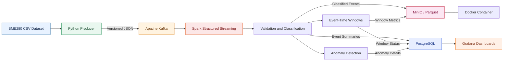

### Architecture Responsibilities

| Component | Responsibility |
|---|---|
| CSV Dataset | Source of historical sensor measurements |
| Python Producer | Reads CSV records, applies source-level checks, constructs JSON events, and publishes to Kafka |
| Apache Kafka | Buffers and distributes streaming events |
| Spark Structured Streaming | Parses events, classifies records, calculates windows, and detects potential anomalies |
| Docker | Runs the MinIO object-storage service through Docker Compose |
| MinIO | Stores event archives and detailed window metrics as Parquet files |
| PostgreSQL | Stores analytical summaries, window-status counts, anomaly details, and batch progress |
| Grafana | Visualizes PostgreSQL data through manually configured dashboard panels |

### Runtime Deployment

The project uses a hybrid local-development setup rather than running the entire stack in containers.

| Component | Execution environment |
|---|---|
| Python producer | Local Python virtual environment |
| Apache Kafka | Local installation |
| Spark Structured Streaming | Local PySpark installation |
| PostgreSQL / PostGIS | Local PostgreSQL installation |
| MinIO | Docker container |
| Grafana | Used for dashboard visualization; deployment and provisioning must be configured separately |

The current `docker-compose.yml` defines the MinIO service. It does not automatically provision Kafka, Spark, PostgreSQL, or importable Grafana dashboards.

## 🔄 Data Flow

### 1. Ingestion

The producer in `src/ingestion/kafka_producer.py` reads a semicolon-delimited CSV incrementally, normalizes measurement values, validates timestamps against the supported period, and applies measurement-quality rules.

It builds versioned JSON events and publishes them to the configured Kafka topic.

### 2. Event Streaming

Apache Kafka buffers the published events. The Spark consumer reads the configured topic using Structured Streaming and tracks Kafka source metadata such as the topic, partition, and offset.

The producer emits event schema version `1.1`; the consumer accepts schema versions `1.0` and `1.1`.

### 3. Processing and Classification

Spark parses and classifies the incoming records. The implementation handles invalid JSON payloads, unsupported schema versions, and measurement-quality statuses.

Accepted events feed the event-time aggregation pipeline.

### 4. Windowed Analytics

The current window configuration is:

| Parameter | Value |
|---|---|
| Window duration | 10 minutes |
| Slide interval | 5 minutes |
| Watermark | 10 minutes |
| Minimum observations | 3 |
| Pressure-range anomaly threshold | 1,000 Pa |
| Temperature-range anomaly threshold | 5 °C |
| Humidity-range anomaly threshold | 20 percentage points |

The pipeline classifies windows according to the implemented rules, including `normal`, `anomaly_suspected`, and `insufficient_data`.

A finite replay does not automatically guarantee that every event-time window has been finalized. Window results must be checked against the watermark and persisted output.

### 5. Persistence

The implementation uses a configurable persistence strategy.

Under Strategy B:

- Classified event records are archived in MinIO as Parquet.
- Detailed window metrics are archived in MinIO as Parquet.
- Accepted-event hourly and daily summaries are stored in PostgreSQL.
- Hourly window-status counts are stored in PostgreSQL.
- Suspected anomaly details and per-sink progress are stored in PostgreSQL.

### 6. Visualization

Grafana queries the PostgreSQL summary tables to display accepted-event counts, time-series metrics, window statuses, anomaly indicators, sensor activity, and other relevant analytical views.

The repository includes PNG screenshots of selected panels. Importable Grafana dashboard JSON and provisioning files are not currently included.

## 🧰 Technology Stack

| Category | Technology |
|---|---|
| Programming | Python |
| Event ingestion | Python `csv` module |
| Messaging | Apache Kafka |
| Stream processing | PySpark Structured Streaming |
| Event format | Versioned JSON |
| Object storage | MinIO |
| Containerization | Docker and Docker Compose |
| Archive format | Apache Parquet |
| S3-compatible access | Hadoop S3A |
| Analytical database | PostgreSQL |
| Database connectivity | `psycopg2` |
| Visualization | Grafana |
| Geospatial database capability | PostGIS geometry columns in legacy tables |

The previously recorded local environment used Python 3.14.7, PySpark 3.5.9, Hadoop AWS 3.3.4, Java 21, and PostgreSQL 18. These are environment observations, not a pinned dependency specification.

Spark's Kafka and S3A connectors must be compatible with the selected Spark, Scala, and Hadoop versions. The repository does not currently provide a complete dependency lock file.

## ✨ Key Features

- Incremental CSV ingestion and bounded message publishing.
- Versioned JSON payloads and schema validation.
- Kafka-based event streaming.
- Data-quality classification and measurement validation.
- Spark Structured Streaming with sliding event-time windows.
- Threshold-based anomaly indicators.
- Parquet archives in MinIO object storage.
- Docker-based MinIO execution.
- PostgreSQL analytical summaries and batch-progress tracking.
- Grafana panels for data exploration and monitoring.
- Dedicated topic, run ID, and checkpoint configuration for isolated benchmark runs.

## 🗄️ Persistence Strategy

The consumer's historical defaults use PostgreSQL for detailed event and window persistence. **Strategy B** is an opt-in configuration that stores detailed records in MinIO and compact analytical outputs in PostgreSQL.

### Strategy B Configuration

```powershell
$env:IOT_SPARK_EVENT_PERSISTENCE_MODE = "silo"
$env:IOT_SPARK_WINDOW_PERSISTENCE_MODE = "silo_summaries"
```

A dedicated `IOT_SPARK_EVENT_SILO_RUN_ID` is required for the event archive and associated summaries.

### Storage Layout

| Data | Destination |
|---|---|
| Classified events | MinIO Parquet under `processed/event_records/` |
| Detailed window metrics | MinIO Parquet under `processed/window_metrics/` |
| Accepted-event hourly summaries | `iot_global_hourly_summaries` |
| Accepted-event daily summaries | `iot_daily_sensor_summaries` |
| Hourly window-status counts | `iot_window_status_hourly` |
| Suspected anomaly details | `iot_sensor_window_anomalies` |
| Sink processing progress | `iot_stream_batch_progress` |

Silo paths are scoped by Kafka topic, run ID, and batch ID. Event-routing and window-processing queries use separate Spark checkpoints.

Batch-level retry handling is implemented, but writes to MinIO and transactions in PostgreSQL are not part of a shared distributed transaction. A partial Parquet prefix may be visible after a failed write. The project does not claim end-to-end exactly-once delivery across Kafka, MinIO, and PostgreSQL.

## 🐳 Docker and MinIO Setup

MinIO provides S3-compatible object storage for Parquet archives. It is executed in a Docker container while Kafka, Spark, and PostgreSQL remain local services.

### Prerequisites

- Docker Desktop installed and running.
- A local `.env.docker` file containing MinIO credentials.
- The project's `docker-compose.yml`.
- An `iot-data-lake` bucket in MinIO.

Keep `.env.docker` local and do not commit credentials.

### 1. Start MinIO

From the project root in PowerShell:

```powershell
docker compose --env-file .env.docker up -d minio
```

Check the service:

```powershell
docker compose ps
```

### 2. Open the MinIO Console

The local endpoints are:

| Service | Address |
|---|---|
| S3 API | `http://localhost:9000` |
| MinIO Console | `http://localhost:9001` |

Sign in using the credentials configured locally in `.env.docker`.

### 3. Create or Verify the Bucket

Create the bucket named:

```text
iot-data-lake
```

The bucket must exist before Spark writes the Parquet archives. The current Compose definition and pipeline do not automatically provision it.

### 4. Configure Spark Access

The consumer reads MinIO credentials from `.env.docker` and expects the endpoint `http://localhost:9000`, path-style S3 access, and the `iot-data-lake` bucket.

The Spark Kafka connector and Hadoop S3A libraries must be available to the Spark runtime. Configure compatible connector versions before starting a new run.

For example, the previously used connector configuration was:

```powershell
$env:PYSPARK_SUBMIT_ARGS = "--packages org.apache.spark:spark-sql-kafka-0-10_2.12:3.5.9,org.apache.hadoop:hadoop-aws:3.3.4 pyspark-shell"
```

Verify compatibility with the local runtime before using this example.

## 📁 Repository Structure

```text
IoT-realtime-pipeline/
├── dashboards/                  # Grafana panel screenshots
├── data/                        # Local datasets and checkpoints; not committed
├── docs/
│   ├── event_schema.md
│   └── window_persistence_strategy.md
├── reports/                     # Profiling and data-quality reports
├── scripts/
│   └── test_silo_spark.py
├── src/
│   ├── ingestion/
│   │   └── kafka_producer.py
│   ├── profiling/
│   ├── storage/
│   │   └── postgres_writer.py
│   └── streaming/
│       ├── anomaly_rules.py
│       ├── event_schema.py
│       ├── json_payload.py
│       ├── kafka_consumer_config.py
│       ├── kafka_spark_consumer.py
│       ├── measurement_rules.py
│       └── pressure_rules.py
├── sql/
│   └── streaming_summary_schema.sql
├── tests/
│   └── unit/
├── docker-compose.yml           # MinIO service
└── README.md
```

The diagnostic script `scripts/test_silo_spark.py` writes to a fixed Silo prefix using overwrite mode. Inspect that destination before running it.

## ⚙️ Configuration

The consumer supports the following environment variables:

| Variable | Purpose | Default / Requirement |
|---|---|---|
| `IOT_KAFKA_TOPIC` | Kafka topic consumed by Spark | `iot-sensor-events-march-pipeline` |
| `IOT_SPARK_MAX_OFFSETS_PER_TRIGGER` | Maximum source offsets per trigger | `100` |
| `IOT_SPARK_EVENT_PERSISTENCE_MODE` | Event persistence mode | `postgres` or `silo` |
| `IOT_SPARK_EVENT_SILO_RUN_ID` | Run ID for Strategy B | Required for event Silo persistence |
| `IOT_SPARK_WINDOW_PERSISTENCE_MODE` | Window persistence mode | `postgres` or `silo_summaries` |
| `IOT_SPARK_ROUTING_CHECKPOINT_DIR` | Routing query checkpoint | Dedicated path required for Strategy B |
| `IOT_SPARK_WINDOW_CHECKPOINT_DIR` | Window query checkpoint | Separate dedicated path required for Strategy B |

For Strategy B, use unique topics, run IDs, producer progress files, and separate routing/window checkpoints for independent runs.

The producer's default topic (`iot-sensor-events`) differs from the consumer's default topic. Always pass the same `--topic` explicitly to both components.

The PostgreSQL writer reads its connection settings from `.env`, including `PGHOST`, `PGPORT`, `PGDATABASE`, `PGUSER`, and `PGPASSWORD`. The consumer reads its MinIO credentials from `.env.docker`.

**Never commit `.env`, `.env.docker`, passwords, access keys, or other secrets.**

## 🚀 Running a Bounded Local Benchmark

The following example demonstrates a controlled 10,000-event run. It does not process the entire source dataset.

### 1. Verify the Environment

Confirm that Kafka, PostgreSQL, and MinIO are available, the bucket exists, and the required Strategy B tables have been created.

The SQL script `sql/streaming_summary_schema.sql` defines the Strategy B tables and indexes. Inspect the target database and apply the SQL using an authorized PostgreSQL client if necessary; the streaming consumer does not automatically execute the DDL.

### 2. Configure an Isolated Run

In PowerShell:

```powershell
$run = "replace-with-unique-run-token"
$topic = "iot-sensor-events-bench-10k-$run"

$env:IOT_KAFKA_TOPIC = $topic
$env:IOT_SPARK_EVENT_PERSISTENCE_MODE = "silo"
$env:IOT_SPARK_EVENT_SILO_RUN_ID = $run
$env:IOT_SPARK_WINDOW_PERSISTENCE_MODE = "silo_summaries"
$env:IOT_SPARK_MAX_OFFSETS_PER_TRIGGER = "100"

$env:IOT_SPARK_ROUTING_CHECKPOINT_DIR = "data/interim/checkpoints/$run-routing"
$env:IOT_SPARK_WINDOW_CHECKPOINT_DIR = "data/interim/checkpoints/$run-windows"
```

Verify that the topic, run ID, output prefixes, progress file, and both checkpoint directories are unused.

### 3. Start the Spark Consumer

```powershell
.\.venv\Scripts\python.exe -m src.streaming.kafka_spark_consumer
```

Wait until both the routing query and window-metrics query have started successfully.

### 4. Publish a Bounded Sample

Open a second PowerShell terminal and set the same `$run` and `$topic` values. Then execute:

```powershell
.\.venv\Scripts\python.exe -m src.ingestion.kafka_producer `
    --input ".\data\raw\2026-03_bme280\2026-03_bme280.csv" `
    --topic $topic `
    --chunk-size 1000 `
    --max-messages 10000 `
    --progress-file ".\data\interim\checkpoints\kafka_producer_$run.json"
```

Confirm that the example CSV path exists before running it.

The `--max-messages` option bounds the number of successfully built and sent events during that producer invocation. Invalid or out-of-period rows can be read and skipped, so a message limit is not a strict source-row limit.

### 5. Validate and Stop

After the producer finishes, allow Spark to process remaining Kafka offsets. Validate Parquet archives, PostgreSQL summaries, window statuses, anomaly records, and sink progress before stopping the run.

For larger replays, increase the bounded target only after reviewing the results and resource usage of the preceding run. The full 87.3-million-row dataset is outside the current validation scope.

### Resuming an Interrupted Run

To resume the same interrupted run, retain the original topic, run ID, producer progress file, and both Spark checkpoints. Do not create new checkpoints for a run that must resume from its previous processing state, and do not assume that blindly rerunning the producer will preserve the intended total.

## 🧪 Testing and Validation

Run the unit tests from the repository root:

```powershell
.\.venv\Scripts\python.exe -m unittest discover -s tests/unit -q
```

The tests cover producer parsing and progress tracking, event schema handling, JSON payload parsing, configuration validation, local Spark transformations, and PostgreSQL writer behavior.

The unit suite is not a full end-to-end integration test of Kafka, Spark, MinIO, and PostgreSQL. Passing unit tests does not establish production readiness.

A previous local validation report recorded **90 unit tests passing** on October 14, 2026. This is a reported historical result; this README update did not execute the tests.

## 📊 Controlled Benchmark Results

The following results are from local subset benchmarks. The complete dataset of approximately 87.3 million rows was not processed.

| Benchmark | Events Archived in MinIO | Accepted | `review_required` | Distinct Event Batches |
|---|---:|---:|---:|---:|
| 10K | 10,000 | 9,303 | 697 | 100 |
| 100K | 100,000 | 92,650 | 7,350 | 200 |
| 250K | 250,000 | 231,547 | 18,453 | 1,000 |

For the 250K benchmark, PostgreSQL Strategy B progress records reached batch ID `1000` for both `event_summaries` and `window_summaries`.

### Interpreting These Results

- The benchmark counts refer to controlled local runs, not full-dataset processing.
- The 250K event total and statuses were verified by reading the resulting Parquet archive in MinIO.
- PostgreSQL stores compact summaries and anomaly details in Strategy B rather than 250,000 detailed event rows.
- The 250K run experienced a Spark interruption and was resumed using its existing checkpoints; the final archive count and PostgreSQL progress markers were verified afterwards.
- These runs do not establish guaranteed throughput, latency, capacity, or production-scale stability.

## 📸 Grafana Screenshots

The `dashboards/` directory contains screenshots of selected Grafana panels. These images document the intended visualizations; they are not importable dashboard definitions.

<details>
  <summary><strong>Accepted Events</strong></summary>

  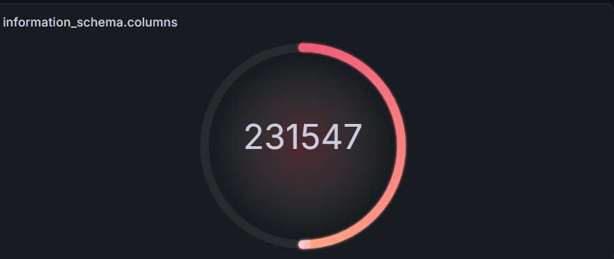
</details>

<details>
  <summary><strong>Hourly Event Volume</strong></summary>

  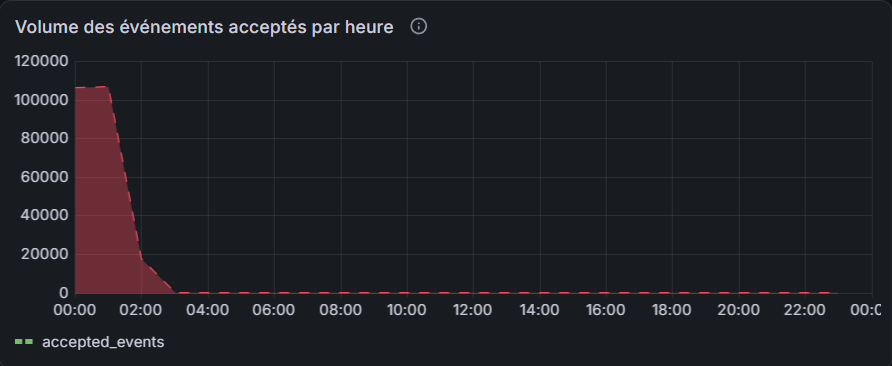
</details>

<details>
  <summary><strong>Data Quality</strong></summary>

  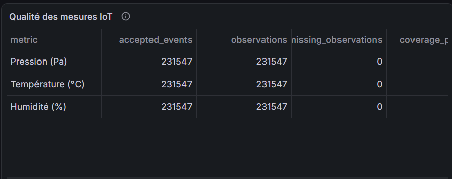
</details>

<details>
  <summary><strong>Window Status Distribution</strong></summary>

  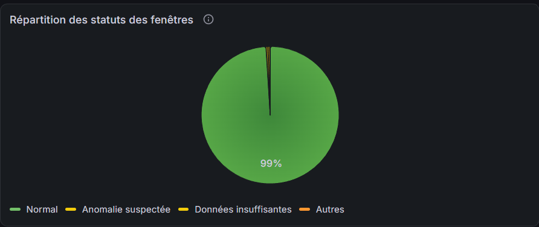
</details>

<details>
  <summary><strong>Suspected Anomalies</strong></summary>

  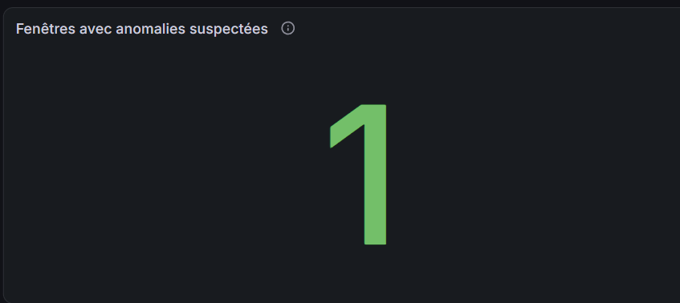
</details>

<details>
  <summary><strong>Average Temperature</strong></summary>

  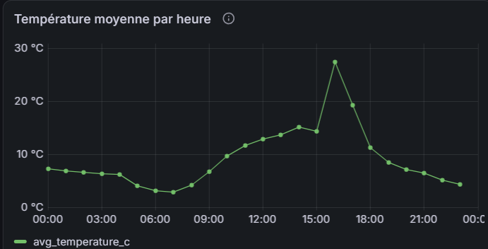
</details>

<details>
  <summary><strong>Average Humidity</strong></summary>

  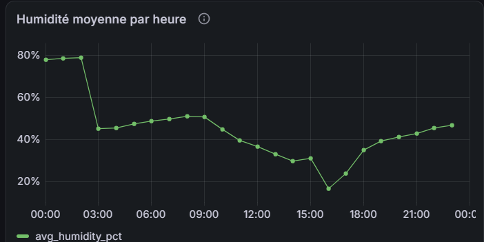
</details>

<details>
  <summary><strong>Average Pressure</strong></summary>

  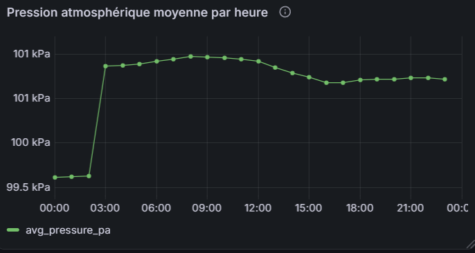
</details>

<details>
  <summary><strong>Top Active Sensors</strong></summary>

  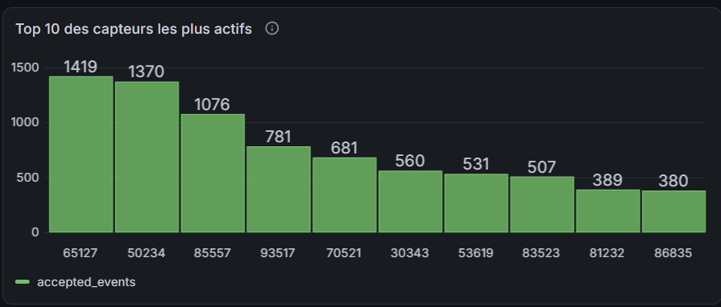
</details>

<details>
  <summary><strong>Sensor Geographic Map</strong></summary>

  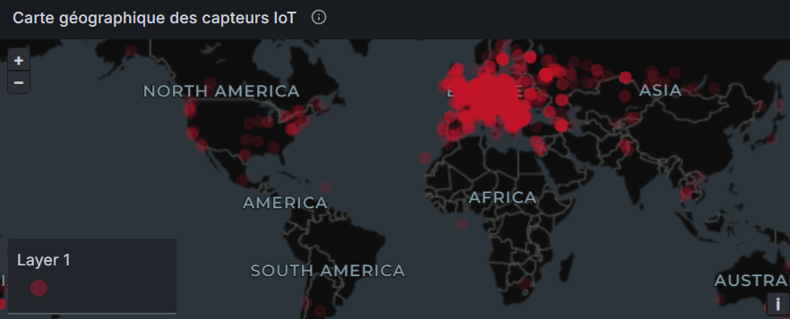
</details>

Dashboard screenshots should only be presented as verified benchmark outputs when their query configuration, time range, topic, run ID, and displayed values have been checked.

## ⚠️ Limitations and Future Improvements

- The full dataset containing approximately 87.3 million rows has not been processed.
- Local subset benchmarks do not prove full-scale capacity, production readiness, or guaranteed performance.
- Spark stability warnings were observed in earlier runs; their definitive root cause has not been established.
- MinIO and PostgreSQL do not share a distributed transaction. Partial Parquet output may be visible after a failed write.
- Strategy B stores detailed events and window metrics in MinIO while PostgreSQL stores compact analytical outputs.
- The repository does not include a complete dependency lock file or automated provisioning for all external connectors.
- Grafana dashboard JSON definitions and dashboard provisioning are not included.
- The producer emits event schema version 1.1, while `docs/event_schema.md` still labels the contract as version 1.0.
- Legacy PostgreSQL tables include PostGIS geometry columns, but Strategy B currently uses numeric coordinates and does not implement a dedicated spatial-processing stage.
- Cloud deployment has not been implemented.

Potential future improvements include dependency management, updated schema documentation, more comprehensive integration testing, Spark stability diagnostics, importable Grafana dashboards, dedicated spatial analytics, and cloud deployment.

---

<p align="center">
  <strong>Built to explore practical real-time data engineering with Kafka, Spark, MinIO, PostgreSQL, and Grafana.</strong>
</p>

<p align="center">
  <sub>Local implementation • Controlled subset benchmarks • Full-dataset processing not performed</sub>
</p>