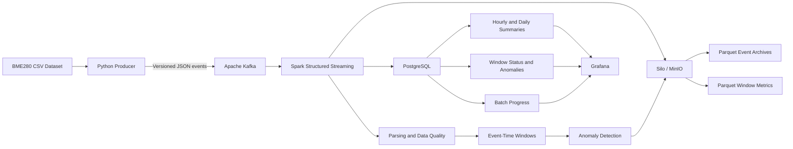

# IoT Real-Time Data Pipeline

**A local real-time data engineering pipeline for IoT sensor ingestion, stream processing, data quality, anomaly detection, and analytics.**

The project processes March 2026 BME280 sensor measurements using Python, Apache Kafka, Apache Spark Structured Streaming, Silo/MinIO object storage, PostgreSQL, and Grafana.

A Python producer reads CSV records incrementally and publishes versioned JSON events to Kafka. Spark processes the event stream, classifies data quality, computes event-time window metrics, and detects potentially abnormal measurements. In the Strategy B persistence mode, detailed event records and window metrics are archived as Parquet in Silo/MinIO, while compact analytical summaries and anomaly information are persisted in PostgreSQL.

> **Project scope:** The original dataset contains approximately 87.3 million rows. Only controlled subsets of 10,000, 100,000, and 250,000 events have been used for pipeline benchmarks. The complete dataset has not been processed.

---

## Table of Contents

- [Project Overview](#project-overview)
- [Architecture](#architecture)
- [Key Features](#key-features)
- [Technology Stack](#technology-stack)
- [Data Flow](#data-flow)
- [Persistence Strategy](#persistence-strategy)
- [Repository Structure](#repository-structure)
- [Local Environment and Docker](#local-environment-and-docker)
- [Prerequisites](#prerequisites)
- [Configuration](#configuration)
- [Running a Controlled Benchmark](#running-a-controlled-benchmark)
- [Testing](#testing)
- [Benchmark Results](#benchmark-results)
- [Grafana Dashboards](#grafana-dashboards)
- [Limitations and Future Improvements](#limitations-and-future-improvements)

---

## Project Overview

The objective is to build and validate a local, streaming-oriented data pipeline that demonstrates how IoT sensor records can be ingested, processed, stored, and analyzed.

### Project Objectives

- Ingest IoT sensor data incrementally from a CSV source.
- Publish validated and versioned JSON events to Apache Kafka.
- Process incoming events using Spark Structured Streaming.
- Classify records according to data-quality rules.
- Calculate event-time sliding-window metrics.
- Identify potentially abnormal pressure, temperature, and humidity measurements.
- Archive classified events and detailed window metrics in Parquet format.
- Store compact analytical summaries and anomaly information in PostgreSQL.
- Visualize the resulting metrics using Grafana.

### Dataset Profile

| Attribute | Description |
|---|---|
| Source | Sensor.Community BME280 sensor measurements |
| Period | March 2026 |
| Original dataset size | 87,298,799 rows |
| Distinct sensors reported | 5,156 |
| Invalid timestamps reported | 18,038 |
| Processing approach | Incremental ingestion and bounded replays |
| Largest completed benchmark | 250,000 events |

The original dataset was not processed end to end. All benchmark results in this repository refer to controlled local runs.

---

## Architecture

The following diagram illustrates the overall pipeline, its main processing stages, the two persistence destinations, and the local deployment arrangement.


### Logical Architecture



### Main Components

| Component | Responsibility |
|---|---|
| Python producer | Reads CSV data, validates measurements, builds JSON events, and publishes to Kafka. |
| Apache Kafka | Buffers and distributes the streaming events through Kafka topics. |
| Spark Structured Streaming | Parses and classifies events, processes event-time windows, and routes outputs to the persistence layers. |
| Silo / MinIO | Stores classified event records and detailed window metrics as Parquet files. |
| PostgreSQL | Stores compact event summaries, hourly window-status counts, suspected anomalies, and processing progress. |
| Grafana | Visualizes analytical results through manually configured dashboards and panels. |
| Docker Compose | Defines the MinIO service used by the local pipeline. |

The architecture image is an overview. Consult the implementation and configuration files for the exact runtime behavior.

---

## Key Features

### 1. Incremental Data Ingestion

The Python producer reads the source CSV incrementally rather than loading the entire dataset into memory.

It supports bounded message publishing, configurable chunk sizes, and a producer progress file for tracking an ingestion run.

### 2. Versioned JSON Events

The producer builds JSON events using schema version **1.1**. The Spark consumer supports versions 1.0 and 1.1.

The processing logic handles malformed JSON, unsupported schema versions, and measurement-quality classifications.

### 3. Stream Processing

Spark Structured Streaming consumes messages from Kafka and processes the incoming data in micro-batches.

The window configuration is:

| Parameter | Value |
|---|---:|
| Window duration | 10 minutes |
| Slide interval | 5 minutes |
| Watermark | 10 minutes |
| Minimum observations for measurement classification | 3 |

A finite replay may leave the newest event-time windows unfinalized. An empty Kafka topic does not, by itself, prove that every window has been emitted.

### 4. Data Quality and Anomaly Detection

The pipeline applies measurement rules and evaluates variations in:

- Pressure
- Temperature
- Humidity

The implemented window-level thresholds are a pressure range of 1,000 Pa, a temperature range of 5 °C, and a humidity range of 20 percentage points.

Windows with fewer than three observations for a measurement can be classified as `insufficient_data`.

Pressure normalization is heuristic. Normalized pascal values should be treated as candidate values rather than independent proof of the original sensor unit.

### 5. Analytical Storage

The pipeline separates detailed records from aggregated analytical data.

Detailed event records and window metrics are archived in Silo/MinIO as Parquet. PostgreSQL stores compact summaries, anomaly details, and per-sink batch progress.

---

## Technology Stack

| Category | Technology |
|---|---|
| Programming language | Python |
| Input format | CSV |
| Event format | JSON |
| Message broker | Apache Kafka |
| Stream processing | Apache Spark Structured Streaming / PySpark |
| Object storage | Silo / MinIO |
| Object storage format | Parquet |
| Object storage connector | Hadoop S3A |
| Relational database | PostgreSQL |
| Geospatial extension | PostGIS available in the local PostgreSQL environment |
| Visualization | Grafana |
| Containerization | Docker Compose for MinIO |
| Testing | Python `unittest` |

Kafka, Spark, and PostgreSQL are managed locally in the current environment. MinIO is containerized with Docker. Grafana panels are configured manually; this repository does not include importable Grafana dashboard definitions or dashboard provisioning.

The repository does not currently provide a pinned Python dependency manifest. Connector versions must be compatible with the installed Spark, Scala, Hadoop, and Java runtime.

---

## Data Flow

### Step 1 — CSV Ingestion

The producer in `src/ingestion/kafka_producer.py` reads the semicolon-delimited CSV incrementally.

It normalizes source values, checks the expected March 2026 timestamp range, applies measurement-quality rules, and creates JSON events.

### Step 2 — Kafka Publishing

The producer publishes JSON events to a configured Kafka topic.

The producer and consumer have different default topic names, so the topic should be specified explicitly for a new run.

### Step 3 — Spark Processing

The Spark consumer parses the events, handles malformed payloads and unsupported schema versions, and classifies the data.

Kafka lineage information is retained in the processed output, including topic, partition, offset, and Kafka timestamp.

### Step 4 — Window Analytics

Accepted events feed event-time sliding windows. Window metrics are evaluated against the implemented anomaly thresholds.

### Step 5 — Data Persistence

Spark writes detailed classified events and window metrics to Silo/MinIO as Parquet. Under Strategy B, PostgreSQL receives compact summaries, window-status counts, suspected anomaly details, and per-sink processing progress.

### Step 6 — Visualization

Grafana queries PostgreSQL to display event counts, data quality metrics, window statuses, anomaly information, sensor activity, and measurements over time.

---

## Persistence Strategy

The consumer's historical default persistence modes are PostgreSQL-based. **Strategy B is opt-in** and uses object storage for detailed outputs alongside PostgreSQL summaries.

### Strategy B Configuration

```text
IOT_SPARK_EVENT_PERSISTENCE_MODE=silo
IOT_SPARK_WINDOW_PERSISTENCE_MODE=silo_summaries
```

The Strategy B window mode requires the event persistence mode to be set to `silo`, a run ID, and separate checkpoint directories for the two Spark queries.

### Data Destinations

| Data | Destination |
|---|---|
| Classified event records, including accepted and review-required events | Silo/MinIO Parquet |
| Detailed window metrics | Silo/MinIO Parquet |
| Accepted-event hourly summaries | `iot_global_hourly_summaries` |
| Accepted-event daily sensor summaries | `iot_daily_sensor_summaries` |
| Hourly window-status counts | `iot_window_status_hourly` |
| Suspected anomaly details | `iot_sensor_window_anomalies` |
| Sink batch progress | `iot_stream_batch_progress` |

### Object Storage Layout

Event archives:

```text
processed/event_records/
  topic=<topic>/
    run_id=<run-id>/
      batch_id=<batch-id>/
```

Window metrics:

```text
processed/window_metrics/
  topic=<topic>/
    run_id=<run-id>/
      batch_id=<batch-id>/
```

The project uses deterministic topic/run/batch paths. Retries target the same batch prefix, and PostgreSQL summary writes and progress updates use database transactions.

However, Silo and PostgreSQL do not share a distributed transaction. A partial Parquet output can remain visible after a failed write, and the project does not guarantee end-to-end exactly-once delivery across all components.

Use a unique topic, run ID, producer progress file, and separate Spark checkpoint paths for each new benchmark. To resume an interrupted run, preserve the original run identity and artifacts rather than reusing them for a different input.

The SQL file `sql/streaming_summary_schema.sql` defines the five Strategy B tables. The application does not apply this DDL automatically. Inspect the target database schema before applying it.

---

## Repository Structure

The main repository layout is:

```text
IoT-realtime-pipeline/
├── README.md
├── IoT Real-Time Data Pipeline Architecture.png
├── docker-compose.yml
│
├── dashboards/
│   ├── accepted-events.png
│   ├── data-quality.png
│   ├── hourly-average-humidity.png
│   ├── hourly-average-pressure.png
│   ├── hourly-average-temperature.png
│   ├── hourly-event-volume.png
│   ├── sensor-geographic-map.png
│   ├── suspected-anomalies.png
│   ├── top-active-sensors.png
│   └── window-status-distribution.png
│
├── data/
│   └── ...                  # Local datasets and processing artifacts
│
├── docs/
│   ├── event_schema.md
│   └── window_persistence_strategy.md
│
├── reports/
│   └── ...                  # Dataset profiling and measurement reports
│
├── scripts/
│   └── test_silo_spark.py
│
├── src/
│   ├── ingestion/
│   │   └── kafka_producer.py
│   ├── profiling/
│   │   └── ...
│   ├── storage/
│   │   └── postgres_writer.py
│   └── streaming/
│       ├── anomaly_rules.py
│       ├── event_schema.py
│       ├── json_payload.py
│       ├── kafka_consumer_config.py
│       ├── kafka_spark_consumer.py
│       ├── measurement_rules.py
│       └── pressure_rules.py
│
├── sql/
│   └── streaming_summary_schema.sql
│
└── tests/
    └── unit/
        └── ...
```

The `data/` directory may contain large local datasets, checkpoints, and progress files. Such local artifacts should not be committed accidentally.

The diagnostic script `scripts/test_silo_spark.py` writes to a fixed Silo prefix using overwrite mode. Inspect its destination before running it.

---

## Local Environment and Docker

The application pipeline is currently run locally, while MinIO runs in Docker.

| Component | Execution environment |
|---|---|
| Python producer | Local |
| Apache Kafka | Local |
| Apache Spark Structured Streaming | Local |
| PostgreSQL / PostGIS | Local |
| MinIO / Silo object storage | Docker |
| Grafana | Manual dashboard setup; not provisioned by the project's Compose file |

The current `docker-compose.yml` defines the MinIO service only. It does not deploy Kafka, Spark, PostgreSQL, or Grafana.

### Start MinIO

Make sure Docker Desktop is running and the local `.env.docker` configuration file exists.

From the repository root, run:

```powershell
docker compose --env-file .env.docker up -d minio
```

Configured endpoints:

| Service | Endpoint |
|---|---|
| MinIO S3 API | `http://localhost:9000` |
| MinIO Console | `http://localhost:9001` |
| Expected bucket | `iot-data-lake` |
| Grafana, when running | `http://localhost:3000` |

The bucket must exist before the pipeline writes to it unless it has been provisioned separately. Kafka and PostgreSQL must be started and configured independently.

Keep `.env` and `.env.docker` local. They contain connection configuration and credentials and must never be committed.

---

## Prerequisites

A local environment requires:

- Python with the project's dependencies.
- Java and a compatible Spark/PySpark installation.
- Apache Kafka and a running broker.
- PostgreSQL with the tables required by the selected persistence mode.
- Docker Desktop and Docker Compose for MinIO.
- Spark Kafka source connector and Hadoop S3A connector libraries compatible with the selected runtime.
- A configured MinIO bucket and local credentials.
- A Grafana instance with a PostgreSQL data source for dashboard visualization.

The repository currently has no dependency lock file or single-command environment installation. Package and connector compatibility must be managed explicitly.

---

## Configuration

The consumer supports the following environment variables:

| Variable | Purpose | Default or requirement |
|---|---|---|
| `IOT_KAFKA_TOPIC` | Kafka topic consumed by Spark | `iot-sensor-events-march-pipeline` |
| `IOT_SPARK_MAX_OFFSETS_PER_TRIGGER` | Maximum source offsets processed per trigger | `100` |
| `IOT_SPARK_EVENT_PERSISTENCE_MODE` | Event detail destination | `postgres` or `silo` |
| `IOT_SPARK_EVENT_SILO_RUN_ID` | Run scope for Strategy B | Required for `silo` mode |
| `IOT_SPARK_WINDOW_PERSISTENCE_MODE` | Window persistence strategy | `postgres` or `silo_summaries` |
| `IOT_SPARK_ROUTING_CHECKPOINT_DIR` | Routing query checkpoint | Dedicated directory |
| `IOT_SPARK_WINDOW_CHECKPOINT_DIR` | Window query checkpoint | Dedicated, separate directory |

The consumer reads MinIO credentials from `.env.docker`. The PostgreSQL writer loads its connection settings from `.env`.

For Strategy B, use fresh routing and window checkpoint directories. Relative checkpoint paths are resolved from the project root.

Example PowerShell configuration for a new isolated run:

```powershell
$run = 'replace-with-a-unique-run-id'
$topic = "iot-sensor-events-bench-10k-$run"

$env:IOT_KAFKA_TOPIC = $topic
$env:IOT_SPARK_EVENT_PERSISTENCE_MODE = 'silo'
$env:IOT_SPARK_EVENT_SILO_RUN_ID = $run
$env:IOT_SPARK_WINDOW_PERSISTENCE_MODE = 'silo_summaries'
$env:IOT_SPARK_MAX_OFFSETS_PER_TRIGGER = '100'

$env:IOT_SPARK_ROUTING_CHECKPOINT_DIR = "data/interim/checkpoints/$run-routing"
$env:IOT_SPARK_WINDOW_CHECKPOINT_DIR = "data/interim/checkpoints/$run-windows"
```

Replace the sample run ID with a unique value and verify that the topic and all paths are unused before starting a new run.

The producer's default topic is `iot-sensor-events`, which differs from the consumer's default. Pass the same topic explicitly to both components.

---

## Running a Controlled Benchmark

**Do not replay the full 87.3-million-row dataset.** The following workflow is intended for a bounded local run.

### 1. Prepare the Services

Ensure that Kafka, PostgreSQL, and MinIO are running. Confirm that the selected Kafka topic, run ID, checkpoint directories, producer progress file, and output prefixes do not already belong to another run.

Verify the target database schema and the `iot-data-lake` bucket before starting the consumer.

### 2. Start the Spark Consumer

In a dedicated PowerShell terminal, configure the environment variables for your new run and execute:

```powershell
python -m src.streaming.kafka_spark_consumer
```

Both Spark queries should use their own checkpoint directory.

### 3. Publish a Bounded Dataset Subset

In a second PowerShell terminal, set the same `$run` and `$topic` values and run:

```powershell
python -m src.ingestion.kafka_producer `
  --input .\data\raw\2026-03_bme280\2026-03_bme280.csv `
  --topic $topic `
  --chunk-size 1000 `
  --max-messages 10000 `
  --progress-file ".\data\interim\checkpoints\kafka_producer_$run.json"
```

This example limits the invocation to 10,000 events successfully built and sent. Invalid or out-of-period CSV rows may be skipped before the message limit is reached, so the number of source rows inspected may be greater than 10,000.

If the run is interrupted, check confirmed Kafka sends and the existing progress before resuming. The limit is per invocation; repeating the producer command does not automatically guarantee a total of exactly 10,000 events.

### 4. Validate the Outputs

After the producer completes:

- Verify archived event counts in Silo/MinIO.
- Compare accepted and `review_required` counts with the benchmark output.
- Check PostgreSQL summary totals and sink progress.
- Inspect window outputs while allowing for event-time watermark finalization.
- Stop the isolated run only after both Spark queries and their outputs have been checked.

For a larger benchmark, use a new isolated topic/run/checkpoint set and change the message limit deliberately. Never reuse a historical benchmark's artifacts.

---

## Testing

Run the unit test suite from the project root:

```powershell
python -m unittest discover -s tests/unit -v
```

The unit suite covers producer parsing and checkpoint behavior, consumer configuration, local Spark transformations, window logic, and mocked PostgreSQL writer behavior.

The Spark-related unit tests can start a local Spark session and write temporary local Parquet data.

**Unit tests are not an end-to-end validation** of Kafka ingestion, PostgreSQL persistence, Silo/MinIO storage, or Grafana integration. No claim of a complete end-to-end test is made here.

---

## Benchmark Results

The following results correspond to completed, controlled local subset runs. They do not represent processing of the entire dataset.

| Benchmark | Events archived in Silo | Accepted | `review_required` | Distinct event batches |
|---|---:|---:|---:|---:|
| 10,000 events | 10,000 | 9,303 | 697 | 100 |
| 100,000 events | 100,000 | 92,650 | 7,350 | 200 |
| 250,000 events | 250,000 | 231,547 | 18,453 | 1,000 |

### Verified 250,000-Event Run

For the completed 250,000-event Strategy B benchmark:

- **250,000** classified event records were verified in Silo/MinIO.
- **231,547** events were classified as accepted.
- **18,453** events were classified as `review_required`.
- The archive contained **1,000 distinct event batches**.
- PostgreSQL event-summary and window-summary progress records both reached batch ID **1,000**.
- PostgreSQL hourly and daily accepted-event summary totals matched **231,547**.

The recorded window-status summaries contained 272 normal windows, one suspected window, and one insufficient-data window. The anomaly table contained one suspected-anomaly record.

These figures describe the observed local benchmark outputs. They are not evidence of full-scale capacity, guaranteed runtime, production readiness, or end-to-end exactly-once delivery.

A previous 100,000-event run also produced Spark stability warnings and heartbeat/Py4J errors. The root cause has not been established, so further reliability testing would be needed before making performance or production claims.

---

## Grafana Dashboards

Grafana panels are configured manually and use PostgreSQL analytical summaries where applicable.

The repository contains PNG screenshots documenting the visualizations. These images are **not importable dashboard definitions**, and no Grafana provisioning configuration is included.

### Accepted Events


### Data Quality


### Hourly Event Volume


### Average Temperature


### Average Humidity


### Average Pressure


### Window Status Distribution


### Suspected Anomalies


### Top Active Sensors


### Sensor Geographic Map


---

## Limitations and Future Improvements

- The complete original dataset of 87,298,799 rows has not been processed; all reported benchmarks use bounded subsets.
- Local benchmarks do not establish full-scale throughput, latency, recovery behavior, or production readiness.
- A previous 100,000-event run had Spark stability warnings that still require diagnosis.
- Silo/MinIO and PostgreSQL do not participate in a shared distributed transaction.
- Python dependencies and external connector versions are not fully pinned in a dependency manifest.
- Grafana dashboard JSON definitions and automated provisioning are not included.
- The event-schema documentation should be kept aligned with the producer's current schema version 1.1.
- Cloud deployment and production orchestration are possible future extensions; they are not implemented in the current project.

---

## Project Status

The project demonstrates a bounded local IoT data engineering pipeline using Kafka, Spark Structured Streaming, Silo/MinIO, PostgreSQL, and Grafana.

The 250,000-event benchmark provides verified evidence of event archiving and Strategy B summary progress for that run. Larger-scale reliability, automated dashboard provisioning, dependency reproducibility, and cloud deployment remain outside the current validated scope.

**Core pipeline:** CSV → Python Producer → Kafka → Spark Structured Streaming → Silo/MinIO + PostgreSQL → Grafana
