# IoT Event Schema


**Versioned data contract for the IoT Real-Time Data Pipeline**

This document defines the canonical structure of an IoT sensor event,
including measurement values, normalization candidates, and data quality
indicators.

It establishes a consistent interface between event producers, Apache Kafka,
Apache Spark Structured Streaming, and downstream storage systems.

---

## Table of Contents

- [1. Purpose and Scope](#1-purpose-and-scope)
- [2. Event Lifecycle](#2-event-lifecycle)
- [3. Design Principles](#3-design-principles)
- [4. Canonical Event Structure](#4-canonical-event-structure)
- [5. Field Reference](#5-field-reference)
- [6. Data Quality Statuses](#6-data-quality-statuses)
- [7. Validation and Data Handling](#7-validation-and-data-handling)
- [8. Source-to-Event Mapping](#8-source-to-event-mapping)
- [9. Schema Versioning](#9-schema-versioning)
- [10. Implementation Checklist](#10-implementation-checklist)

---

## 1. Purpose and Scope

The pipeline processes environmental sensor data from the
[Sensor.Community](https://sensor.community/) project.

The source dataset contains BME280 sensor measurements, including pressure,
temperature, and relative humidity.

The event contract provides a standard format for:

- Representing sensor measurements consistently.
- Preserving original values for traceability.
- Separating raw measurements from derived values.
- Recording data quality validation results.
- Supporting downstream stream processing and storage.

> **Important:** Passing the current validation rules does not guarantee
> that a measurement is physically correct. Pressure unit inference remains
> a candidate classification until independently confirmed.

## 2. Event Lifecycle

The following diagram illustrates the intended flow of an event through
the pipeline.

```mermaid
flowchart LR
    A["Raw Sensor Dataset"] --> B["Parsing"]
    B --> C["Normalization Candidates"]
    C --> D["Quality Validation"]
    D --> E["Canonical IoT Event"]
    E --> F["Apache Kafka"]
    F --> G["Spark Structured Streaming"]
    G --> H["PostgreSQL / PostGIS"]

    classDef source fill:#e0f2fe,stroke:#0284c7,color:#0f172a
    classDef processing fill:#ede9fe,stroke:#7c3aed,color:#0f172a
    classDef messaging fill:#fef3c7,stroke:#d97706,color:#0f172a
    classDef storage fill:#dcfce7,stroke:#16a34a,color:#0f172a

    class A source
    class B,C,D,E processing
    class F messaging
    class G,H storage
```



The event schema sits between data validation and event publication.
It ensures that downstream components consume a predictable payload.

## 3. Design Principles

| Principle | Description |
|---|---|
| Consistency | Use stable field names and documented data types. |
| Traceability | Preserve original measurement values whenever available. |
| Explicit quality | Attach validation statuses to every event. |
| Non-destructive processing | Do not silently remove suspicious measurements. |
| Unit awareness | Distinguish original pressure values from normalized candidates. |
| Interoperability | Represent events as standard JSON objects. |
| Evolution | Version the contract when its structure or semantics change. |

## 4. Canonical Event Structure

Each event contains five top-level fields or sections:

- `schema_version`: identifies the contract version.
- `sensor_id`: identifies the source sensor.
- `timestamp`: represents the source measurement time.
- `measurements`: contains original and derived measurement values.
- `quality`: contains the results of data quality validation.

### Example JSON payload

```json
{
  "schema_version": "1.0",
  "sensor_id": "39287",
  "timestamp": "2026-03-01T00:01:55",
  "measurements": {
    "pressure_raw": "1002.0",
    "pressure_numeric": 1002.0,
    "pressure_pa_candidate": 100200.0,
    "pressure_unit_candidate": "hPa_candidate",
    "temperature_c": 25.9,
    "humidity_pct": 93.0
  },
  "quality": {
    "pressure_status": "converted_from_hpa",
    "temperature_status": "valid_temperature",
    "humidity_status": "valid_humidity",
    "humidity_at_boundary": false,
    "record_status": "accepted_candidate"
  }
}
```

This example illustrates the intended structure. The pressure conversion
is a candidate result produced by the current rules, not independent proof
of the sensor's actual unit.

### Payload organization

| Section | Responsibility |
|---|---|
| Event metadata | Identifies the schema and source measurement. |
| Measurements | Holds the original values and derived candidates. |
| Quality | Records the result of each validation rule. |

## 5. Field Reference

### 5.1 Event Metadata

| Field | Type | Description |
|---|---|---|
| `schema_version` | String | Version of the event contract. |
| `sensor_id` | String | Identifier of the originating sensor. |
| `timestamp` | String | Source measurement timestamp in ISO 8601 format. |

The sensor identifier is represented as a string to avoid imposing numeric
semantics on an identifier.

The source timestamp must be preserved. If the source does not specify
a timezone, the pipeline must not invent one.

### 5.2 Measurements

| Field | Type | Description |
|---|---|---|
| `pressure_raw` | String or null | Original pressure representation retained for traceability. |
| `pressure_numeric` | Number or null | Numeric pressure value before normalization. |
| `pressure_pa_candidate` | Number or null | Candidate pressure value expressed in pascals, when a conversion is proposed. |
| `pressure_unit_candidate` | String or null | Candidate unit inferred by the pressure rules. |
| `temperature_c` | Number or null | Temperature in degrees Celsius. |
| `humidity_pct` | Number or null | Relative humidity in percent. |

**Pressure normalization:** values interpreted as hPa candidates may be
multiplied by 100 to produce a Pa candidate. Values interpreted as Pa
candidates are retained numerically. These rules are heuristic and must
not be interpreted as confirmed sensor metadata.

### 5.3 Quality Indicators

| Field | Type | Description |
|---|---|---|
| `pressure_status` | String | Result of pressure validation and candidate normalization. |
| `temperature_status` | String | Result of temperature validation. |
| `humidity_status` | String | Result of humidity validation. |
| `humidity_at_boundary` | Boolean | Indicates whether humidity is exactly 0% or 100%. |
| `record_status` | String | Overall quality assessment for the event. |

## 6. Data Quality Statuses

### 6.1 Pressure Status

| Status | Meaning |
|---|---|
| `missing_or_nonnumeric` | Pressure is missing or cannot be interpreted numerically. |
| `invalid_nonpositive` | Pressure is zero or negative. |
| `converted_from_hpa` | An hPa-like value was converted to a Pa candidate. |
| `converted_from_hpa_out_of_range` | The hPa-like candidate produces a converted value outside the configured range. |
| `valid_pa` | Pressure falls within the configured Pa candidate range. |
| `outside_candidate_ranges` | Pressure falls outside the configured candidate ranges. |

### 6.2 Temperature and Humidity Status

The current validation rules use the following configured ranges:

| Measurement | Accepted numeric range | Example status |
|---|---|---|
| Temperature | -40 to 85 °C | `valid_temperature` |
| Relative humidity | 0 to 100% | `valid_humidity` |

Measurements outside the configured range are marked for review.
Missing values are represented by field-specific missing statuses.

The configured ranges support data quality screening. They do not prove
that a reading is accurate or that the sensor is functioning correctly.

### 6.3 Overall Record Status

| Status | Meaning |
|---|---|
| `accepted_candidate` | Current validation rules accept the measurements, with no humidity boundary condition. |
| `accepted_with_humidity_boundary` | Measurements pass the current rules, but humidity equals 0% or 100%. |
| `review_required` | At least one measurement requires further investigation. |

The overall status is a preliminary quality classification. It is not a
guarantee of physical accuracy.

## 7. Validation and Data Handling

Every event must follow these rules:

1. **Preserve source values.** Retain original measurements whenever available.
2. **Separate derived values.** Store normalization results separately from source values.
3. **Keep suspicious records traceable.** Flag them rather than silently deleting them.
4. **Handle missing values consistently.** Use JSON `null` for missing values.
5. **Produce valid JSON.** Do not serialize non-standard numeric values such as `NaN` or `Infinity`.
6. **Preserve timestamp semantics.** Do not invent timezone information.
7. **Record quality decisions.** Include the relevant status fields in each event.
8. **Avoid unsupported assumptions.** Treat pressure unit classifications as candidates until confirmed.

## 8. Source-to-Event Mapping

The following mapping defines how source columns are represented in the
canonical event.

| Source column | Canonical field | Transformation |
|---|---|---|
| `sensor_id` | `sensor_id` | Convert to a consistent string representation. |
| `timestamp` | `timestamp` | Preserve the source timestamp semantics. |
| `pressure_raw` | `measurements.pressure_raw` | Retain the original representation. |
| `pressure_numeric` | `measurements.pressure_numeric` | Preserve the parsed numeric value. |
| Derived by pressure rules | `measurements.pressure_pa_candidate` | Store the candidate normalized value. |
| Derived by pressure rules | `measurements.pressure_unit_candidate` | Store the candidate unit classification. |
| `temperature` | `measurements.temperature_c` | Map to the documented Celsius field. |
| `humidity` | `measurements.humidity_pct` | Map to the documented relative humidity field. |
| Derived by validation | `quality.*` | Store individual validation statuses and the overall record status. |

The mapping is logical: the event producer is responsible for transforming
the tabular source into the nested JSON structure described above.

## 9. Schema Versioning

The initial contract version is **1.0**.

Changes must be reviewed before being introduced into the pipeline.

| Change | Recommended approach |
|---|---|
| Add an optional field | Assess compatibility with existing consumers. |
| Rename or remove a field | Treat as a potentially breaking change. |
| Change a field's meaning or data type | Review the contract and version accordingly. |
| Change validation semantics | Update the relevant documentation and tests. |

All producer and consumer implementations must follow the same documented
contract version.

## 10. Implementation Checklist

Before publishing an event to Kafka, verify that:

- [ ] The payload follows the canonical structure.
- [ ] `schema_version`, `sensor_id`, and `timestamp` are present.
- [ ] Measurement fields use the documented types.
- [ ] Original and derived pressure values remain distinguishable.
- [ ] Quality indicators are populated by the validation rules.
- [ ] Missing and non-finite values are handled consistently.
- [ ] The event can be serialized as valid JSON.
- [ ] Unit tests cover valid, invalid, missing, and boundary measurements.

---

**Document:** `docs/event_schema.md`  
**Contract version:** `1.0`  
**Project:** IoT Real-Time Data Pipeline  
**Status:** Initial schema specification
